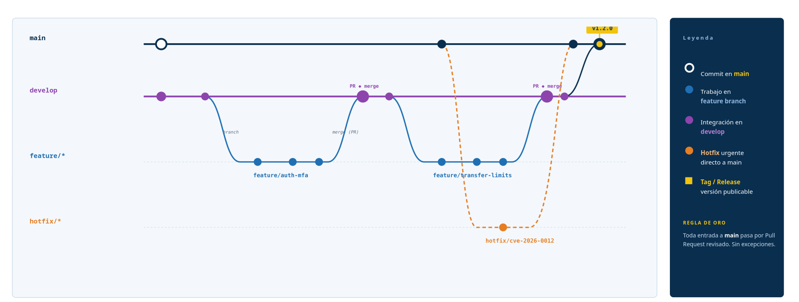

# SecureBank API


Proyecto académico de DevSecOps.

## Descripción

SecureBank API es una API bancaria simulada utilizada
para estudiar arquitectura, seguridad y automatización
CI/CD.

**Es un caso hipotético.** SecureBank no es una aplicación real ni pretende serlo. La Sesión 1 plantea *qué fallos tendría* una API bancaria hecha sin seguridad, y cada sesión aplica la herramienta o el control DevSecOps que los corregiría si esa API existiera. El poco código que hay en [src/](src/) es un ejemplo mínimo que sirve para que las herramientas (Semgrep, ZAP, pytest, Trivy, Cosign…) tengan algo sobre qué correr. Por eso los estados de abajo miden si **el control está aplicado y demostrado**, no si la API tiene todas sus funcionalidades.

Leyenda: ✅ hecho con evidencia en el repo · 🟡 parcial · 🔴 pendiente · 👤 falta una acción del equipo (ejecutar, capturar o exportar)

## Los 9 fallos de SecureBank (Sesión 1)

| # | Fallo deliberado | OWASP | Sesiones que lo atacan | Cómo se corrigió y en qué archivos | Estado |
|---|---|---|---|---|---|
| 1 | Credenciales en el código | A02 · A07 | S5, S7 | Los secretos se leen desde variables de entorno y la app no arranca si faltan o son débiles ([src/config.py](src/config.py)). Gitleaks revisa en el pre-commit y en el CI ([.gitleaks.toml](.gitleaks.toml), [.pre-commit-config.yaml](.pre-commit-config.yaml)). Procedimiento en [docs/SECRETS.md](docs/SECRETS.md) | ✅ |
| 2 | Dependencias vulnerables | A06 | S6, S10, S13 | pip-audit encontró 17 avisos reales (16 CVE + 1 GHSA) en `PyJWT 2.10.1` (1 Critical, CVSS 9.1). Se subió a `2.15.0` en [requirements.txt](requirements.txt) y quedó en 0 CVE. SBOM y reporte con semáforo CVSS en [reports/](reports/README.md) | ✅ |
| 3 | SQL Injection | A03 | S5 | Consulta parametrizada `WHERE username = ?` en [src/users/users.py](src/users/users.py). SAST 10 → 0, con tabla OWASP y diff en [docs/sesion-05-sast/](docs/sesion-05-sast/README.md) | ✅ |
| 4 | Autorización insuficiente | A01 | S3, S8 | JWT con algoritmo fijo y expiración ([tokens.py](src/auth/tokens.py)) y `require_owner` con registro de auditoría ([middleware.py](src/auth/middleware.py)). Prueba BOLA en [test_bola.py](tests/security/test_bola.py) | ✅ |
| 5 | Contenedor corriendo como root | A05 | S10, S12 | `USER appuser` (uid 10001) en [docker/Dockerfile.v2](docker/Dockerfile.v2). `read_only` y `cap_drop: ALL` en [docker-compose.dast.yml](docker-compose.dast.yml). `runAsNonRoot` en [k8s/hardened/](k8s/hardened/deployment.hardened.yaml) | ✅ |
| 6 | Secretos en variables inseguras | A02 | S7, S11, S12 | Secretos efímeros y enmascarados en el CI, OIDC hacia AWS, `secretKeyRef` en K8s para `JWT_SECRET` y `DATABASE_URL`, KMS en [kms.tf](infra/terraform/kms.tf). Inventario y rotación en [docs/SECRETS.md](docs/SECRETS.md) | ✅ |
| 7 | Configuraciones cloud deficientes | A05 | S11, S12 | Terraform escaneado por Checkov en [iac.yml](.github/workflows/iac.yml): 307 aprobados, 0 fallidos (100 %). Top 5 hallazgos en el [informe](docs/sesion-11-iac/informe-iac.md) | 🟡 👤 falta el `checkov-before.json` real |
| 8 | Ausencia de monitoreo y trazabilidad | A09 | S3, S11 | Registro `securebank.audit` de intentos BOLA ([middleware.py](src/auth/middleware.py)), CloudTrail y VPC flow logs ([logging.tf](infra/terraform/logging.tf), [network.tf](infra/terraform/network.tf)) | 🟡 |
| 9 | Pipeline CI/CD sin controles | A08 | S2, S4, S5, S6, S8, S9, S13 | [ci.yml](.github/workflows/ci.yml): Gitleaks → Semgrep → Trivy → cobertura → ZAP → gate OPA con falla cerrada. Firma con Cosign de la imagen real en [supply-chain.yml](.github/workflows/supply-chain.yml) | 🟡 👤 falta el run con la imagen nueva |

## Qué arregla cada sesión

El detalle ítem por ítem del checklist de cada presentación está en [docs/CHECKLIST.md](docs/CHECKLIST.md).

| Sesión | Entregable que pide la clase | Fallos | Cómo lo resuelve el repo | Archivos | Estado |
|---|---|---|---|---|---|
| S1 · Intro DevSecOps | Diagrama del ciclo: 8 fases, herramienta y rol por fase | marco | Diagrama Mermaid y tabla de controles por fase | [ciclo-devsecops.md](docs/sesion-01-ciclo/ciclo-devsecops.md) | 🟡 👤 PDF |
| S2 · Git y repos seguros | POL-REPO-001 (roles, reglas, matriz, excepciones) | 1, 9 | Política R.01–R.07, CODEOWNERS por carpeta, flujo `feature/* → develop → main` | [POL-REPO-001.md](docs/sesion-02-repos/POL-REPO-001.md), [CODEOWNERS](.github/CODEOWNERS) | 🟡 👤 roles y protección de `main` |
| S3 · Threat Modeling | ≥ 10 amenazas con sus controles, DFD | 4, 8 | STRIDE T01–T10, DFD, 5 fronteras de confianza, Security Stories; revisión al día | [threat-model.md](docs/sesion-03-threat-model/threat-model.md) | ✅ |
| S4 · CI/CD | Pipeline v1.0 sin secretos y con badge | 9 | 5 etapas, permisos mínimos, artefacto por commit; doc con todos los jobs | [ci.yml](.github/workflows/ci.yml), [pipeline.md](docs/sesion-04-ci/pipeline.md) | 🟡 👤 captura del run |
| S5 · SAST | SARIF antes/después + tabla OWASP + diff + URL del run | 1, 3 | 5 defectos corregidos (10 → 0) y tests de cada corrección | [docs/sesion-05-sast/](docs/sesion-05-sast/README.md) | 🟡 👤 URL del run |
| S6 · SCA y SBOM | `reports/securebank-sbom.cdx.json` + `reports/securebank-vulns.html/.json` | 2 | SBOM CycloneDX 1.5 (18 componentes) + 17 avisos con CVSS y semáforo; corrección PyJWT → 0 CVE | [reports/](reports/README.md) | 🟡 👤 descomentar los pasos del CI |
| S7 · Secretos | `docs/SECRETS.md` (6 secciones) + Gitleaks en hook y CI + evidencia | 1, 6 | Inventario, alternativas, Gitleaks, rotación, respuesta y `.env.example` | [SECRETS.md](docs/SECRETS.md), [.env.example](.env.example) | 🟡 👤 run bloqueado (§6) |
| S8 · DAST y APIs | Reporte ZAP (PDF) + `report.json` + plan de mitigación | 4, 9 | ZAP baseline, BOLA corregido, cabeceras de seguridad; tabla antes/después ilustrativa | [docs/sesion-08-dast/](docs/sesion-08-dast/README.md) | 🟡 👤 scan real y PDF |
| S9 · Quality Gates | `.rego` + README + caso que pasa y caso que bloquea | 9 | 20 tests OPA, consolidador y `gate.sh`; contexto de riesgo sin mitigaciones falsas | [policy/](policy/README.md), [security-context.json](config/security-context.json) | ✅ |
| S10 · Docker | Dockerfile endurecido + comparativo Trivy v1 vs v2 | 5, 2 | No root, slim, solo el puerto 8000, 381 → 219 MB; riesgos residuales actualizados | [docker/REPORT.md](docker/REPORT.md) | 🟡 👤 aplicar 3 parches y volver a escanear |
| S11 · IaC y Cloud | Terraform, `iac.yml`, Checkov antes/después (≥ 85 %), informe | 7, 6, 8 | 100 % en Checkov, OIDC, `apply` con aprobación; informe con el top 5 | [infra/](infra/README.md), [informe-iac.md](docs/sesion-11-iac/informe-iac.md) | 🟡 👤 before real y PDF |
| S12 · Kubernetes | `deployment.hardened.yaml` (securityContext, digest, `secretKeyRef`) | 5, 6 | Los 7 controles + secretos alineados con la app (M2) | [k8s/hardened/](k8s/hardened/deployment.hardened.yaml) | 🟡 👤 digest real y kubesec |
| S13 · Supply chain | Build + digest, SBOM Syft, Cosign, verificación que bloquea, análisis | 9, 2 | Ahora firma la imagen real (`Dockerfile.v2`) con tag por SHA | [supply-chain.yml](.github/workflows/supply-chain.yml), [docs/sesion-13-supply-chain/](docs/sesion-13-supply-chain/reporte-s13.md) | 🟡 👤 run nuevo y Rekor |

## Qué falta para tener todo en verde

Revisión del 2026-11-25. Con `pytest`, los 30 tests pasan. Todo lo que se podía resolver dentro del repo ya está hecho. Lo que queda necesita que alguien del equipo ejecute, capture o configure algo:

1. **GitHub (S2, S4):** proteger `main` (PR, Code Owners, status checks `CI` y `Security Gate (OPA)`, firmas obligatorias, MFA) y guardar capturas. Definir quién es el Lead de seguridad y quién el SRE en [CODEOWNERS](.github/CODEOWNERS).
2. **Runs del pipeline (S4, S5, S7, S13):** hacer push y pegar las URLs del run en verde, del bloqueo de Gitleaks (prueba comentada en [SECRETS.md](docs/SECRETS.md) §6) y de la firma con la imagen real, con su `logIndex` de Rekor.
3. **Scans reales (S8, S10, S11, S12):** reemplazar la tabla ilustrativa de ZAP por el `report.json` del job `dast`, generar `checkov-before.json` (comando en el [informe](docs/sesion-11-iac/informe-iac.md)), volver a escanear la imagen v2 con los parches y correr kubesec.
4. **Automatizar S6:** descomentar los pasos del job `sca` en [ci.yml](.github/workflows/ci.yml) para que `reports/` salga del pipeline.
5. **PDF (S1, S8, S11):** exportar el diagrama del ciclo, el reporte DAST y el informe IaC.

> **Ojo con el próximo run:** `config/security-context.json` ya no declara mitigaciones, así que el gate es más estricto (0 SCA Critical, máximo 2 SCA High). Además, `supply-chain.yml` ahora construye `docker/Dockerfile.v2`.
>
> Por ser un caso hipotético **no se consideran pendientes** las funcionalidades de una API real (`POST /transfer`, MFA, rate limiting, UUID). El [threat model](docs/sesion-03-threat-model/threat-model.md) ya define sus controles.

## Arquitectura

Las carpetas están ordenadas según el ciclo del pipeline. La evidencia de cada clase está en `docs/sesion-XX-tema/`, y el índice de **todos los archivos** ordenados por sesión está en [docs/README.md](docs/README.md).

```text
src/        API de ejemplo (blueprints Flask, auth, JWT, control BOLA)
tests/      unit/ · security/ · policy/fixtures/ · integration/
policy/     Política Rego del Security Gate + sus pruebas (S9)
scripts/    Consolidador de hallazgos y gate.sh (S9)
config/     Contexto de riesgo que lee el gate (S9)
lab/        Datos de laboratorio para DAST (S8)
docker/     Dockerfile v1 (inseguro), v2 (endurecido), s13 y REPORT.md (S10, S13)
infra/      Terraform + README de Checkov (S11)
k8s/        Deployment endurecido (S12)
.github/    Workflows ci.yml, iac.yml, supply-chain.yml y CODEOWNERS
docs/       Arquitectura, img/ y una carpeta por sesión (S1–S13)
```

Archivos de la raíz: `requirements.txt` (Python), `package.json` (job `build` de relleno), `docker-compose.dast.yml` (entorno DAST), `.gitleaks.toml` y `.pre-commit-config.yaml` (S7), `.gitignore` y `.dockerignore`. La carpeta `material-curso/` (las presentaciones) está en `.gitignore` y no se versiona.


## Configuración de repositorio

Este proyecto sigue un flujo de trabajo basado en ramas protegidas, con integración continua vía Pull Requests.

### Estrategia de ramas

- **`main`**: rama de producción. Contiene únicamente código estable y liberado. Cada commit en `main` representa una versión publicable.
- **`develop`**: rama de integración. Las features terminadas se mezclan acá antes de pasar a `main`.
- **`feature/*`**: ramas de desarrollo de nuevas funcionalidades, creadas desde `develop` (ej. `feature/auth-mfa`, `feature/transfer-limits`).
- **`hotfix/*`**: ramas para correcciones urgentes de seguridad o bugs críticos, creadas directamente desde `main` cuando no se puede esperar al ciclo normal (ej. `hotfix/cve-2026-0012`).

### Flujo de trabajo



1. Se crea una rama `feature/*` desde `develop` para cada nueva funcionalidad.
2. Al finalizar, se abre un **Pull Request** hacia `develop` para su revisión e integración.
3. Cuando `develop` acumula suficientes cambios estables, se abre un PR de `develop` hacia `main`.
4. Los releases publicables se marcan con un **tag** de versión (ej. `v1.2.0`) sobre `main`.
5. Ante una vulnerabilidad o bug urgente, se crea una rama `hotfix/*` directo desde `main`, se corrige y se mergea de vuelta a `main` (y luego se sincroniza con `develop`).

> ⚠️ **Regla de oro:** toda entrada a `main` pasa por Pull Request revisado. Sin excepciones.

## § 2 · Roles y responsabilidades

Los roles completos y la tabla de "quién puede qué" están en [POL-REPO-001.md](docs/sesion-02-repos/POL-REPO-001.md).

## DAST (Sesión 8)

Guía del laboratorio con OWASP ZAP, corrección de BOLA y entregable en [docs/sesion-08-dast/](docs/sesion-08-dast/README.md).

## Security Quality Gate (Sesión 9)

Política como código con OPA + Rego que decide `DEPLOY` o `BLOCK` en cada build: ver [policy/README.md](policy/README.md) y [docs/sesion-09-quality-gates/](docs/sesion-09-quality-gates/README.md).

