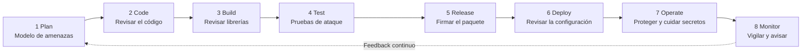

# Ciclo DevSecOps de SecureBank

Este dibujo muestra las 8 etapas del ciclo y el control de seguridad que se usa en cada una.

| Etapa | Control de seguridad | Herramienta | Responsable |
|---|---|---|---|
| 1. Plan | Modelo de amenazas (STRIDE) y requisitos de seguridad | Threat Dragon | Arquitecto / Dueño del producto |
| 2. Code | Revisión automática del código y búsqueda de secretos | Semgrep, gitleaks | Desarrollador |
| 3. Build | Revisión de librerías e imágenes | Trivy | Desarrollador / DevOps |
| 4. Test | Pruebas de ataque en un ambiente de prueba | OWASP ZAP | QA / Seguridad |
| 5. Release | Firma del paquete y lista de componentes | Sigstore (Cosign), Syft | DevOps |
| 6. Deploy | Revisión de la infraestructura y del contenedor | Checkov | DevOps / Cloud |
| 7. Operate | Manejo de secretos, firewall web y parches | Vault, ModSecurity | Operaciones / SRE |
| 8. Monitor | Registros, alertas y respuesta a incidentes | Grafana, Wazuh | Seguridad (SOC) / SRE |
