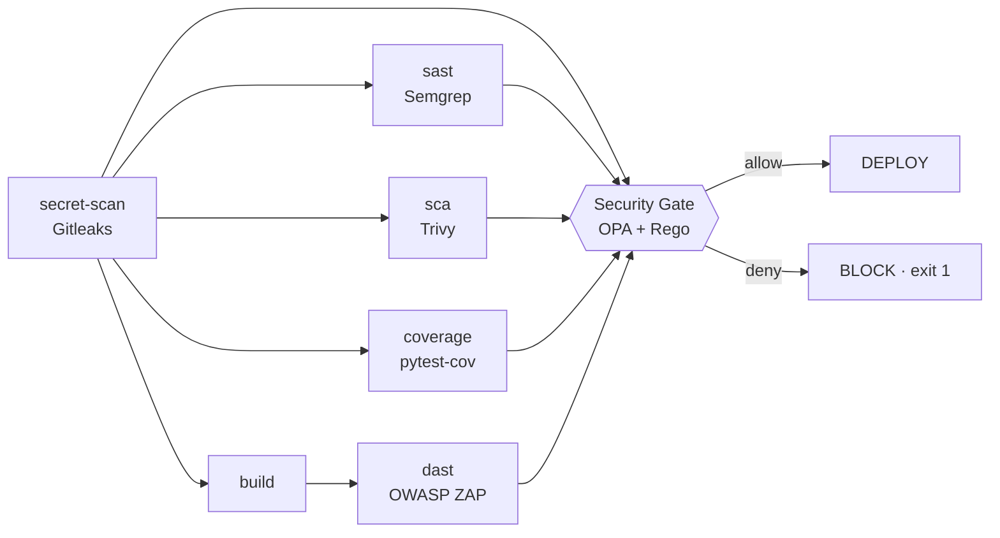

# Sesión 9 · Security Quality Gates y Policy as Code

Cierre de la Unidad II. Proyecto SecureBank API. Requiere Sesiones 5–8 (Secret Scan, SAST, SCA, DAST).

## Objetivo

Pasar de **escanear** a **decidir**: el pipeline consolida los hallazgos de los cuatro scanners y una política en Rego responde, sin humanos de por medio, si el build puede avanzar.

## Pipeline resultante



El job `gate` usa `if: always()`: corre aunque un scanner haya fallado, y en ese caso bloquea (falla cerrada).

## Qué se agrega al repositorio

| Archivo | Para qué sirve |
|---|---|
| `policy/security-policy-v1.rego` | La política (Policy as Code) |
| `policy/security-policy-v1_test.rego` | 20 pruebas con `opa test` |
| `policy/README.md` | Umbrales, justificación, criterios de riesgo (parte del entregable) |
| `config/security-context.json` | Criticidad, exposición y compensating controls de SecureBank |
| `scripts/consolidate_findings.py` | Une los reportes de los scanners en `findings.json` |
| `scripts/gate.sh` | Ejecuta OPA, imprime el resumen y devuelve exit 0/1 |
| `tests/policy/fixtures/` | Entradas «verde», «rojo» y «debate #482» |
| `tests/unit/` | Pruebas del consolidador y de calc/export/auth/config (cobertura ~99 %) |
| `.github/workflows/ci.yml` | Jobs nuevos: `sast`, `sca`, `coverage`, `gate` |

## Pasos del laboratorio

1. **Consolidar** los reportes en `findings.json`:
   ```bash
   python scripts/consolidate_findings.py \
     --gitleaks gitleaks.sarif --sast sast.sarif --sca sca.json \
     --dast zap-out/report.json --coverage coverage.json \
     --context config/security-context.json -o findings.json
   ```
2. **Escribir la política**: `policy/security-policy-v1.rego` (las 4 reglas de la clase más KEV, riesgo y falla cerrada).
3. **Invocar OPA como step del CI** y capturar el exit code: `scripts/gate.sh findings.json`.
4. **Probar con un commit verde y uno rojo**:
   ```bash
   scripts/gate.sh tests/policy/fixtures/green.json   # DEPLOY · exit 0
   scripts/gate.sh tests/policy/fixtures/red.json     # BLOCK  · exit 1
   ```

Requisitos locales: `opa` (1.9.0), `jq`, Python 3.11+ y `pip install -r requirements.txt`.

## Caso de debate: build #482 (0 Critical · 3 High · 12 Medium)

Resultado de evaluar el caso con esta política, variando solo el contexto (cada fila se puede reproducir con OPA):

| Escenario | Decisión | Motivo |
|---|---|---|
| A. Internet, crítico, sin controles | **BLOCK** | SCA High 3 > 2 · Medium 12 > 10 |
| B. A + WAF y rate limiting realmente desplegados | **BLOCK** | Medium 12 > 10 |
| C. B + bajar Medium a 10 | **DEPLOY** | Cumple todo |
| D. Servicio interno, sin Internet (3 High, 12 Medium) | **DEPLOY** | High 3 <= 4 · Medium 12 <= 15 |
| E. D con 16 Medium | **BLOCK** | Medium 16 > 15 |

Lectura: la política no defiende ni «bloquear siempre» ni «desplegar por la fecha». Para un banco expuesto a Internet sin controles se acerca a la postura A, pero deja un camino medible y auditable hacia `DEPLOY` (corregir hallazgos y desplegar controles reales) en lugar de una excepción verbal. Ojo: el escenario B solo vale si el WAF y el rate limiting existen; hoy no están desplegados (ver `policy/README.md`, «Decisiones a revisar»). Es la respuesta a «la fecha de salida es mañana»: cambia el riesgo, no el umbral.

## Limitaciones a tener presentes

- **Los jobs `sast`, `sca` y `gate` no se ejecutaron en un runner real al prepararse esta sesión.** Las partes que sí se probaron localmente: la política (`opa test`: 20/20), el consolidador (`pytest`: 30/30), `gate.sh` con los casos verde/rojo y un recorrido de punta a punta usando el SARIF real de Semgrep de la Sesión 6 y la cobertura real medida. Valida el primer run del PR en GitHub Actions.
- **Configuración de Semgrep:** el job usa `p/default`. Si en la Sesión 6 usaste otro ruleset, ajústalo para que los resultados sean comparables.
- **Mapeo de severidades:** Semgrep no entrega Critical/High/Medium nativos. Se usa `security-severity` si existe y, si no, el nivel SARIF (`error → High`, `warning → Medium`, `note → Low`). ZAP no tiene nivel Critical. Documenta esta convención si cambias de herramienta.
- **KEV depende de cisa.gov:** si la descarga falla, el job `gate` falla (no se omite el criterio de exploitability en silencio).
- **ZAP `-I` (Sesión 8)** sigue sin romper el job `dast`: el que decide ahora es el gate.
- **Los criterios de riesgo declarados no se verifican solos:** `mitigations` es una declaración. Mantén `config/security-context.json` bajo revisión de seguridad.
- El PR toca `.github/workflows/`: según POL-REPO-001 necesita 2 aprobaciones, una de seguridad. Además, para que el gate sea obligatorio hay que marcar el check `Security Gate (OPA)` como requerido en la protección de `main` (R.07).

## Próxima sesión

Sesión 10 · Seguridad de contenedores y Docker (Unidad III): se pasa del código y sus dependencias a la imagen.
